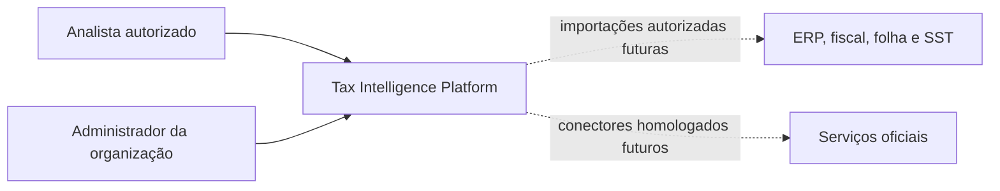
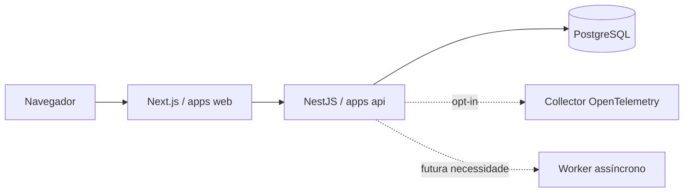
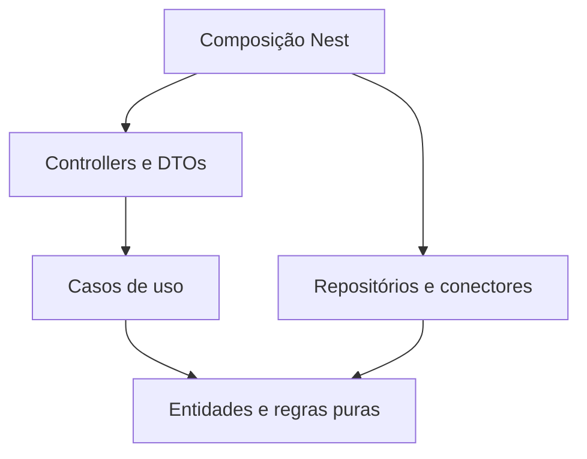

# Arquitetura da fundação

Preparação documental do [ADR 0029](../adr/0029-nfe-source-discovery.md): [RFC 0004](../rfc/0004-nfe-xml-intake.md) propõe parser de XML NF-e em adapter Fiscal, somente após aprovação do recorte e fixação do schema. Nenhum import, componente, rota, tabela ou dependência foi implementado nessa pesquisa; fonte real, assinatura e regra fiscal não estão homologadas.

O [ADR 0028](../adr/0028-synthetic-diagnostic-telemetry.md) mantém spans HTTP opt-in com rota/status e acrescenta traceId válido ao log para correlação. Prova compilada API/RSA/PostgreSQL com collector JSON local; sem novos spans de domínio ou propagação distribuída web/API. [Evidências e limites](../engineering/synthetic-diagnostic-telemetry-validation.md).

Interface sintética do [ADR 0027](../adr/0027-synthetic-diagnostic-ui.md) compõe lote e diagnóstico em workspace por organização/sessão/papel. Repetição explícita conserva body natural; React exibe evidência da API sem cálculo. [Validação](../engineering/synthetic-diagnostic-ui-validation.md). Entrega em branch, sem integração em main; recortes anteriores abaixo são históricos.

BFF de diagnóstico do [ADR 0026](../adr/0026-synthetic-diagnostic-bff.md) usa contratos, sessão existente e transporte HTTP. Sem ampliar acesso SQL da web; API revalida autorização. [Evidências](../engineering/synthetic-diagnostic-bff-validation.md). Interface acrescentada pelo ADR 0027; recortes abaixo registram etapas anteriores.

Composição HTTP de diagnóstico no [ADR 0025](../adr/0025-synthetic-diagnostic-http.md): módulo Nest usa application e store existentes, Bearer e pool PostgreSQL dedicado quando configurado, sem SQL em controller/domain ou nova permissão. Pool opcional para iniciar o bootstrap; necessário para executar operações, que retornam 503 quando ausente, sem fallback. [Validação](../engineering/synthetic-diagnostic-http-validation.md). Recortes anteriores abaixo descrevem suas entregas originais; BFF acrescentado no ADR 0026; interface acrescentada no ADR 0027.

Persistência de diagnóstico implementada no [ADR 0024](../adr/0024-synthetic-diagnostic-persistence.md): snapshot público Fiscal, execução versionada e evento na mesma transação autorizada, com perfil restrito e RLS nas duas relações novas. Store injetado no caso de uso, sem runtime/rota; [evidências PostgreSQL e serviço compilado](../engineering/synthetic-diagnostic-persistence-validation.md). Execução remota e interface permanecem pendentes.

Contratos e casos de uso de execução implementados no [ADR 0023](../adr/0023-synthetic-diagnostic-use-cases.md): validação por schemas, criação/replay/consulta e evidência comparada ao núcleo real, através de uma porta transacional específica. Sem adapter, SQL, módulo Nest ou rota. Testes de porta não equivalem à autorização/atomicidade reais. [Validação](../engineering/synthetic-diagnostic-use-cases-validation.md).

Preparação da execução registrada na [RFC 0004](../rfc/0004-synthetic-diagnostic-execution.md), proposta em revisão: snapshot público de Fiscal, autorização revalidada e confirmação atômica do resultado versionado com seu evento na mesma transação. Login próprio e duas relações novas propostos; nenhuma mudança de runtime, SQL ou privilégios implementada por essa preparação. [Matriz planejada](../engineering/synthetic-diagnostic-execution-test-plan.md).

Núcleo puro de diagnóstico sintético no [ADR 0022](../adr/0022-synthetic-diagnostic-core.md): application valida o contrato público do lote e chama domínio independente de infraestrutura. Resultado versionado DEMO-TOTAL-001 com evidências inteiras exatas, sem fonte normativa/validade fiscal. Não registrado em módulo Nest, rota, UI ou banco; execução autorizada sobre lote persistido e auditoria continuam pendentes. [Validação](../engineering/synthetic-diagnostic-core-validation.md).

API do lote sintético implementada no [ADR 0019](../adr/0019-synthetic-document-http.md): controller → serviço/porta de aplicação → repository → adapters transacionais públicos do ADR 0018. POST/GET exigem Bearer e pool com login dedicado; tabelas novas mantêm RLS e auditoria atômica. BFF implementado no [ADR 0020](../adr/0020-synthetic-document-bff.md) com sessão existente, Origin/CSRF e chave idempotente, sem ampliar acesso SQL da web. Interface implementada no [ADR 0021](../adr/0021-synthetic-document-ui.md), com criação, recuperação explícita e consulta pelo BFF. Execução registrada do diagnóstico permanece pendente; núcleo puro no ADR 0022. [Validação da interface](../engineering/synthetic-document-ui-validation.md).

Prova sintética RLS implementada no [ADR 0016](../adr/0016-synthetic-rls-proof.md), sem alterar runtime ou tabelas da aplicação. Demonstra policies/contexto somente em fixtures; aplicação a dados de domínio continua pendente. [Status do projeto](../engineering/project-status.md).

Interface administrativa implementada conforme [ADR 0015](../adr/0015-administrative-membership-ui.md), consumindo somente o BFF existente e mantendo autorização na API. Criação de identidade, reativação, RLS e operação fiscal permanecem pendentes. [Validação](../engineering/administrative-membership-ui-validation.md).

BFF administrativo implementado conforme [ADR 0014](../adr/0014-administrative-membership-bff.md), com token server-side, Origin/CSRF e autorização revalidada pela API. Não concede acesso SQL de domínio ao web nem implementa UI administrativa. [Validação](../engineering/administrative-membership-bff-validation.md).

**Decisão técnica desta etapa:** monorepo pnpm/Turborepo e monólito modular NestJS, com Next.js como aplicação web independente. A API e o frontend são dois processos, sem decomposição dos domínios em microsserviços. [ADR 0001](../adr/0001-modular-monolith.md).

## C4: contexto

## C4: containers planejados

## Componentes e dependências

Domain não importa Nest, ORM, React ou transporte. Application define portas quando houver uma fronteira real; não criar interfaces apenas para espelhar classes. Infrastructure implementa persistência e serviços externos. Presentation traduz contrato em comando e erro de domínio em resposta. Módulos são compostos na API; um contexto não importa arquivos internos de outro.

`apps/web` usa `ui` e `contracts`; `apps/api` usa `contracts` e `database`; `database` não conhece controllers; `contracts` contém DTOs operacionais e schemas de transporte, sem entidades persistidas; `config` compartilha configurações, não regras. Referências entre pacotes sempre pelo nome público. Aplicar restrições de importação no bootstrap e estendê-las a contextos quando criados.

## Estado concreto

Consulta administrativa paginada de membros implementada no [ADR 0013](../adr/0013-administrative-membership-directory.md), com UUID/papel/estado e autorização no mesmo snapshot da leitura. [Validação](../engineering/administrative-membership-directory-validation.md). Complementa a API administrativa; a UI foi implementada no ADR 0015.

Endpoints operacionais, tela de disponibilidade, verificação de access tokens, login/sessões BFF, consulta de memberships, seleção no navegador e revogação administrativa na API estão implementados com testes. A API compõe módulos públicos de autenticação, organizações, Fiscal Compliance e Tax Intelligence; serviços usam portas independentes de Nest/ORM. Revogação revalida administrador ativo na transação, preserva o último administrador e grava evento atômico com locks. BFF acessa somente sessões técnicas e consulta memberships pela API; seleção não persiste autorização. Alteração de papéis existentes também está implementada, conforme [ADR 0011](../adr/0011-membership-role-changes.md), com [evidências](../engineering/membership-role-validation.md). Concessão a atores existentes está implementada no [ADR 0012](../adr/0012-membership-grants.md), sem reativação ou bootstrap de administrador. Importação real, prova OTLP específica, regras/permissões fiscais reais e RLS de controle/dados reais seguem pendentes. [Evidências técnicas](../engineering/bootstrap-validation.md), [sessões BFF](../engineering/bff-session-validation.md), [memberships](../engineering/membership-validation.md), [seleção no navegador](../engineering/browser-organization-validation.md), [revogação](../engineering/membership-revocation-validation.md), [mapa de contextos](../domains/context-map.md), [contratos](api.md), [persistência](persistence.md), [evolução](evolution.md).
